# OpenWS3 user guide

How to use a WhoopStor V3 charger running OpenWS3: reading the screen, starting a charge, and what every setting does.
All pictures are what the unit's 160 x 80 screen shows; they are drawn by the firmware's own screen code (`make screens`).

> **This firmware is early.** You are charging lithium cells with software that is still being tested. Stay with the
> charger and use it at your own risk. See `README.md` for the status and for how to install it.

## Contents

1. [The two buttons](#the-two-buttons)
2. [Start up](#start-up)
3. [The main screen](#the-main-screen)
4. [Charging](#charging)
5. [Per-port settings](#per-port-settings)
6. [The menu](#the-menu)
7. [Running from a weak supply: the limits](#running-from-a-weak-supply-the-limits)
8. [USB data with XT60 power](#usb-data-with-xt60-power)
9. [Themes](#themes)
10. [Sounds](#sounds)
11. [Default settings](#default-settings)
12. [When something is wrong](#when-something-is-wrong)

## The two buttons

There are two buttons under the screen: **left (B1)** and **right (B2)**. Everything is done with four gestures:

| Gesture | Name in this guide | Where |
|---|---|---|
| tap one button | **B1** / **B2** | everywhere |
| hold one button | **hold B1** / **hold B2** | on the main screen |
| tap both together | **OK** | everywhere |
| hold both together for 0.8 s (a beep) | **BACK** | menus and port settings |

In the menus a held single button repeats, faster the longer you hold it, so long value lists scroll quickly.
To press both buttons together, press them within about 0.2 s of each other and release.

## Start up

The unit shows its logo and beeps twice, then the main screen. It needs an input of about 4.6 V or more: below that it shows
`INPUT LOW` and waits until a supply is connected.

| Logo | No input |
|---|---|
|  | 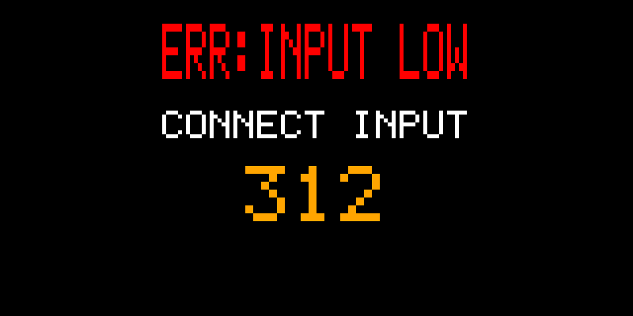 |

## The main screen

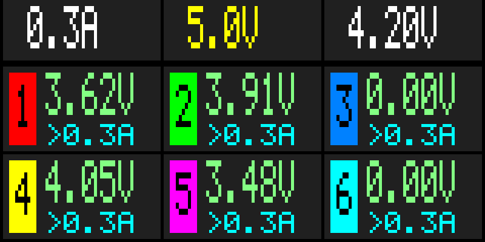

**Top row, three boxes**

| Box | Shows |
|---|---|
| left | the charge current each port gets (`0.3A`). A `*` after it means some port has its own current or is switched off |
| middle | the input voltage (`5.00V`). When the unit stops on its own, the reason replaces it, see [When something is wrong](#when-something-is-wrong) |
| right | the target voltage the cells are charged to (`4.20V`) |

The boxes turn red while charging.

**The six cells** are the six ports, numbered by the coloured tab. Each shows the port's voltage and, below it, what it is doing.
An empty port reads `0.00V`. A cell reading below 1.00 V is treated as not there: a deeply discharged cell is not charged.

The line under the voltage and the small square in the corner give the port state:

| Line | Square (CLASSIC theme) | Meaning |
|---|---|---|
| `>0.3A` | none | idle: the current this port will charge at when you start |
| `OFF` (dim) | none | idle, and this port is set to sit the run out |
| `TEST` | yellow | a cell was found; the charger is checking it before charging |
| `0.60A` | red | charging, at the measured current |
| `LIMIT` | red | charging is wanted but an [input limit](#running-from-a-weak-supply-the-limits) holds this port until there is room |
| `REST` | orange | output off for a moment; the cell voltage is read to decide what to do next |
| `FULL` | white; the whole cell is tinted green | the cell is at the target voltage; the port keeps watching it |
| `BLEED` | blue | the cell is above the target, so the port discharges it down to the target |
| `ERR` | magenta, blinking | over-voltage or over-current on that port; it stays off until you remove the cell or stop the run |

While charging, a port shows its measured current, and for one second in four the current it is aiming for (`>0.6A`).

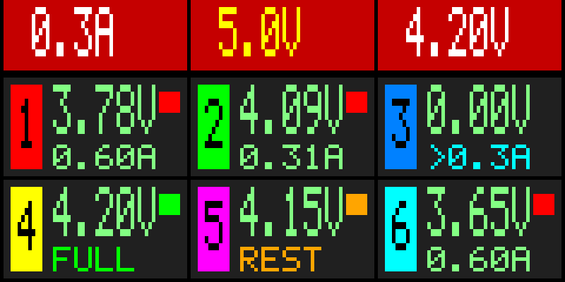

A port held by a limit shows `LIMIT`, and a port set to `OFF` shows `OFF`; the `*` marks that some ports differ from the rest:

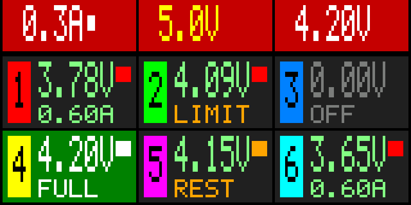

## Charging

**Set the current and the voltage** before you start (both are locked while charging):

| Action | Effect |
|---|---|
| **B1** tap | charge current +0.1 A: 0.3 A, 0.4 A ... 1.3 A, then back to 0.3 A |
| **B2** tap | target voltage: 4.20 V, 4.35 V, 3.80 V storage, 3.85 V storage, then back to 4.20 V |

The choice is saved a few seconds after your last tap.

| Target | Use |
|---|---|
| 4.20 V | a normal full charge |
| 4.35 V | a full charge for high-voltage (HV) cells only. Never use it on a cell that is not rated for 4.35 V |
| 3.80 V storage, 3.85 V storage | storage charge: the same as a full charge, but to a lower voltage, for cells you will not use for a while |

A cell that is **above** the target is discharged down to it (`BLEED`), whichever target you chose.
Check the target before you insert a cell that you want to keep full.

**Start and stop:** hold **B1** (about 0.35 s). Each port with a cell begins charging, ramping its current up gently. Hold **B1** again to stop.
A cell inserted after the start is picked up too. A run does not end by itself: when every port says `FULL` the ports stay on guard and top a
cell up if it sags, so stop the run when you are done.

The charger beeps twice when a port becomes full. It stops on its own if the input drops too low or something is wrong with the
supply (see [When something is wrong](#when-something-is-wrong)).

## Per-port settings

Every port can charge at its own current, or be left out of the run. **Hold B2** on the main screen. The top row says `PORTS`, and
port 1 gets a frame.

| | Selecting a port | Editing a value |
|---|---|---|
| **B1** / **B2** | previous / next port | value down / up (hold to repeat) |
| **OK** | edit this port | confirm |
| **BACK** | done, saves | cancel, the old value comes back |
| 10 s without a key | done, saves | cancel, done |

The value steps through `OFF`, `AUTO`, and 0.3 A to 1.3 A. `AUTO` means the current from the top-left box. The small word under the value
says which kind it is (`AUTO`, `SET` or `OFF`).

| Selecting (port 2 has its own current, port 5 is off) | Editing port 2 (the frame blinks) | While charging |
|---|---|---|
| 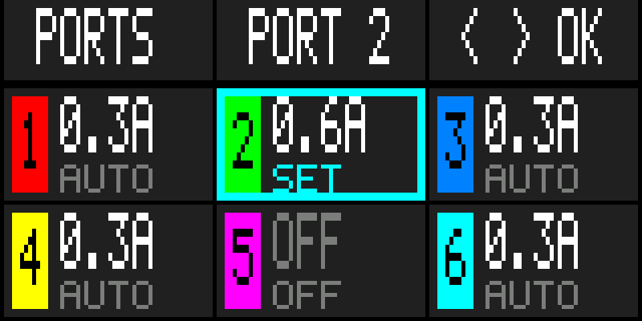 | 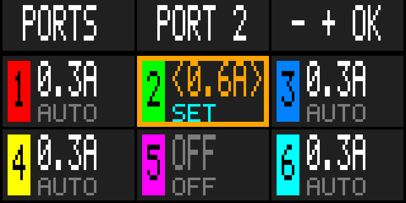 | 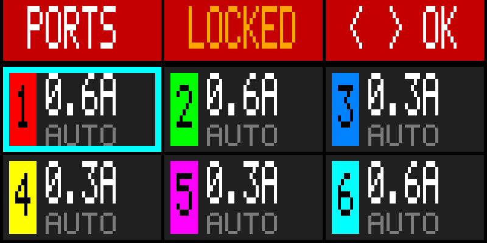 |

While charging you can look at the values but not change them (`LOCKED`).

## The menu

**Tap both buttons (OK)** on the main screen to open the menu. It works while charging too, but the voltage and the current are then locked.

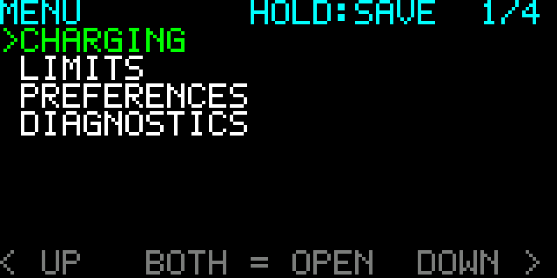

There are four categories. The top row shows where you are, the key hint, and the position (`1/4`). The bottom row always shows what
the two buttons do right now.

| In | B1 | B2 | OK | BACK |
|---|---|---|---|---|
| category list | up | down | open the category | close the menu and save |
| a category | up | down | edit the item | back to the categories |
| editing an item | value down | value up | keep the value | cancel, the old value comes back |

Lists wrap around. A new value works at once; everything is saved when you close the menu, and only what changed is written.

While you edit, the item is marked orange and the bottom row changes to `< -`, `BOTH OK`, `+ >`:

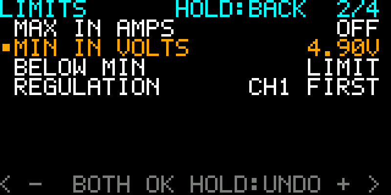

### Settings

| Category | Item | What it does |
|---|---|---|
| **CHARGING** | VOLTAGE | the target voltage, as the right button does on the main screen |
| | CURRENT | the charge current, 0.3 to 1.3 A in 0.1 A steps |
| **LIMITS** | MAX IN AMPS | a ceiling on the current taken from the input: `OFF`, or 0.5 to 3.0 A in 0.1 A steps, then 0.5 A steps up to 10 A |
| | MIN IN VOLTS | a floor for the input voltage: `OFF`, or 4.80 to 5.00 V in 0.05 V steps, up to 6.0 V in 0.1 V steps, then 0.5 V steps up to 25 V |
| | BELOW MIN | what happens when the input falls below that floor: `LIMIT` or `STOP RUN` |
| | REGULATION | which ports get the available current first: `EQUAL`, `CH1 FIRST` or `HIGH V FIRST` |
| **PREFERENCES** | SOUND | beeps `ON` or `OFF` |
| | THEME | the colours: `CLASSIC`, `CALM`, `AMBER`, `HIGH CONTRAST` |
| | DISABLE USB POWER | `NO` or `YES`. With `YES` the USB-C input is never switched on: use it when the charger is powered from the XT60 and the USB-C is only a data link to a computer (monitor, web page, flashing). A computer then neither powers the unit nor gets power from it. While it is on, the input voltage in the header is green and reads `USB OFF` for a second every four seconds, so you can see at a glance that the USB-C is isolated. On USB alone the unit shows `INPUT LOW` with `USB POWER OFF, USE XT60` and waits for the XT60; the menu still opens, so the setting can be switched back. Not while charging; takes effect at once, switching back to `NO` waits for the next start |
| **DIAGNOSTICS** | | the technical pages, see below |

| CHARGING | LIMITS | PREFERENCES |
|---|---|---|
| 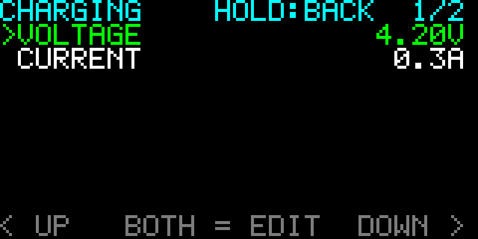 | 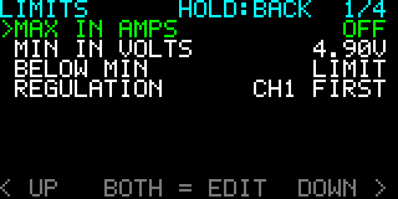 | 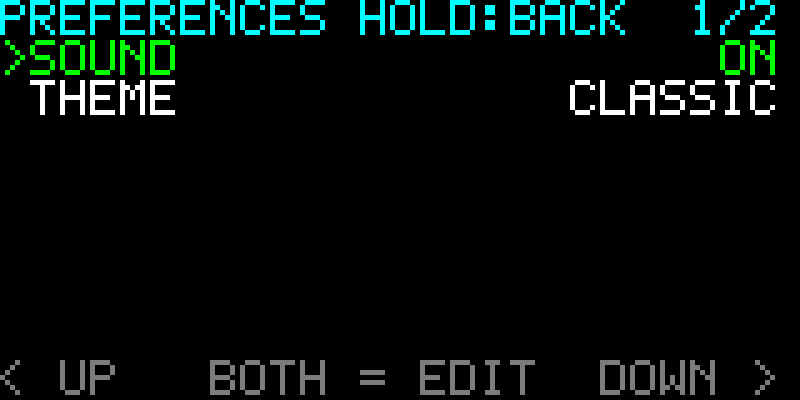 |

While a run is going, **OK** on VOLTAGE or CURRENT does nothing and the bottom row says why:

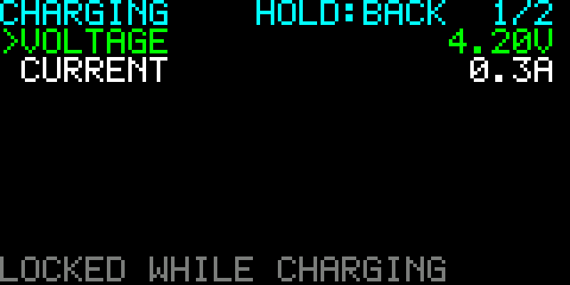

### Diagnostics

DIAGNOSTICS opens six pages of raw readings for troubleshooting: power, port voltages, port currents, status, raw ADC values and the limits.
**B2** is the next page, **B1** the previous one, and **BACK** returns to the menu. You do not need them for normal use.
The limits page (6) is the one worth knowing: it shows the estimated input current, the power budget and which ports are held (`H`) or waiting (`W`).

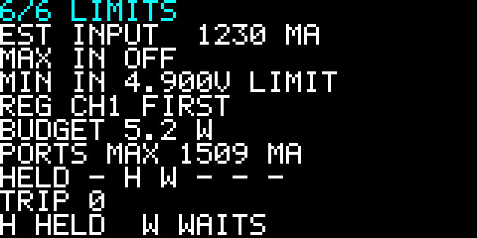

## Running from a weak supply: the limits

A PC USB port, a small power bank or a battery pack cannot supply as much as a wall adapter. The charger cannot know what its source can
deliver, so you tell it. Both limits work on one **power budget**, the most the ports may draw together; the smaller of the two rules.

* **MAX IN AMPS** caps the current taken from the input. The charger estimates it from what the ports draw. Use the rating of your supply:
  for example 0.5 A for a USB 2.0 port.
* **MIN IN VOLTS** protects a source that sags under load. The default is 4.90 V, just above the point where the charger refuses to run
  (about 4.6 V). With **BELOW MIN** on `LIMIT` the charger lowers the charge current while the input is below the floor and lets it recover once
  the input is back, so a weak source steadies itself instead of collapsing. With `STOP RUN` the charger stops the run after one second below
  the floor and shows `V LIMIT` in the input box.

  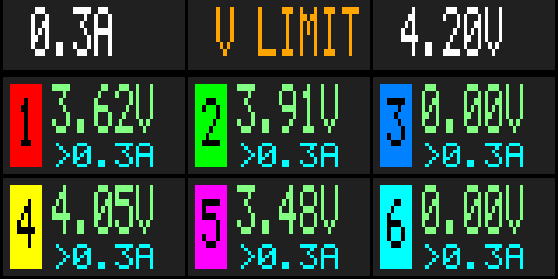

* **REGULATION** decides who gets the current when the budget is short:

| REGULATION | Who gets the current first |
|---|---|
| `EQUAL` | the port with the lowest current, so the currents even out |
| `CH1 FIRST` | port 1, then port 2 and so on. The highest port number is reduced first, down to nothing (`LIMIT`) |
| `HIGH V FIRST` | the cell with the highest voltage, so the nearly full cells finish first |

A port held back by a limit shows `LIMIT` and starts again as soon as there is room. Ports only grow into the budget, never past it, so a newly
inserted cell cannot draw more before the others have given way.

### Example: charging from a laptop USB port

A laptop port gives a few watts and its voltage sags as you load it. The charger throttles itself to keep the input above the floor you
set in MIN IN VOLTS, so that setting is how you tune it to the source. A lower floor lets the source sag further before the
charger backs off, so more current flows. Set it too low and the source runs out of what it can give and browns out: the port resets,
or the laptop switches it off.

1. Leave MIN IN VOLTS at its default of **4.90 V** and BELOW MIN on `LIMIT`. This works with most ports.
2. Put one or two cells in, then **hold B1** to start. Watch the middle box on the main screen: it shows the input voltage under load.
   Ports that cannot get room show `LIMIT`, and the currents of the others drop. That is the limiter keeping the input at the floor, not a fault.
3. If the source copes and charging is slower than you need, lower the floor one step, to **4.85 V**. The charger then lets the input sag a bit
   more before it throttles, so the ports draw more.
4. If the port drops out, or the laptop disconnects it, the floor is too low for that source. Raise it a step (4.90 V, then 4.95 V, 5.00 V) and try again.
5. A weak or long-cable source needs a higher floor than a strong one, so the right value can change with the laptop, the port and the cable.
   You can change MIN IN VOLTS while charging, so you can adjust it during a run.

Changes of 0.05 V matter here, so move one step at a time. Below 4.80 V the menu does not go, and under about 4.6 V the charger refuses to run at all.
MAX IN AMPS is a second way to cap the draw, if you know what your port is rated for. The limits page in DIAGNOSTICS (page 6) shows the estimated
input current and the budget the charger is working to.

**From a LiPo pack:** the charger does not detect the pack or its cell count. Set MIN IN VOLTS to the pack's cut-off voltage (about 3.3 V per
cell: 6.6 V for 2S, 13.2 V for 4S, 19.8 V for 6S) and BELOW MIN to `STOP RUN`, so charging stops before the pack is over-discharged.
The unit itself stays on and draws a little current: unplug it from the pack when you are done.

## USB data with XT60 power

The USB-C input has a switch that, once the USB supply has been negotiated, bypasses a diode in the input path. That switch conducts both
ways: with it on, the voltage on the XT60 reaches the USB-C connector. So a charger powered from a battery or a bench supply on the XT60
must not have a computer connected to its USB-C unless the switch is kept off.

To use the monitor, the web page or flashing while the charger runs from the XT60:

1. Open the menu and set **DISABLE USB POWER** to `YES` (not while charging).
2. Check the input voltage in the header: it is **green**, and reads `USB OFF` for a second every four seconds. This is the sign that the
   switch is off and cannot be turned on, so it is safe to connect the computer.
3. Connect the USB-C cable. The computer neither powers the unit nor gets power from it; only data passes.

With the setting on, the switch stays off after every start and cannot be turned on from the menu, the PC link or the web page. Powered from
USB alone the unit shows the amber `INPUT LOW` screen with `USB POWER OFF, USE XT60` and waits for the XT60; the menu still opens to
switch the setting back. Set it back to `NO` to charge from a USB-C supply again.

## Themes

The theme changes colours only, never behaviour, and applies at once. In every theme the same colours mean the same kind of thing
(red/orange for charging and warnings, green for good, blue for bleed). A full cell is tinted in every theme, so it shows from
across the room (green; in `AMBER` a brighter amber).

| CLASSIC | CALM |
|---|---|
|  | 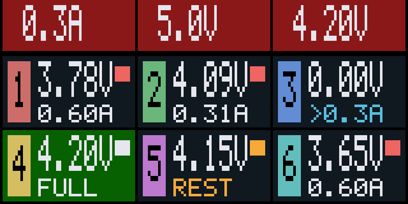 |
| **AMBER** | **HIGH CONTRAST** |
| 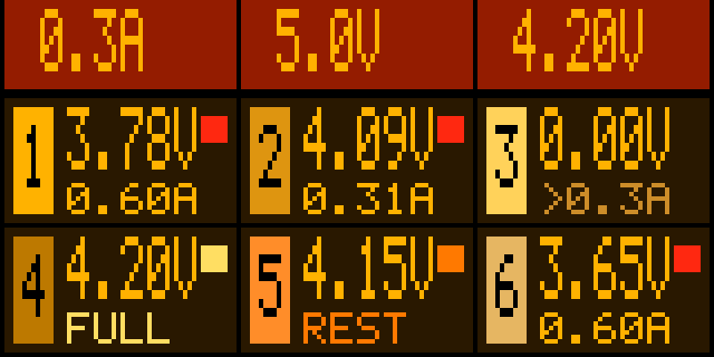 | 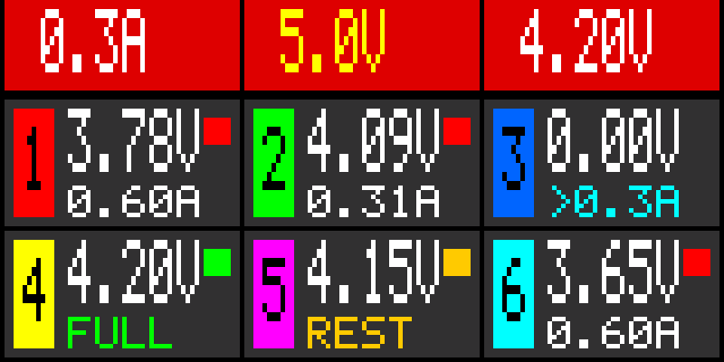 |

`CLASSIC` is the original look, `CALM` colours only what carries meaning, `AMBER` is one hue on black with red for trouble, and
`HIGH CONTRAST` uses pure colours.

## Sounds

| Sound | When |
|---|---|
| two short bursts | the unit has started |
| one short beep | a button press was accepted |
| two beeps | a port has become full |
| two long beeps | an error: a port fault, a stop by MIN IN VOLTS, or a locked item that you tried to change |
| a repeating triple beep | the output rail is out of regulation (`RAIL!`): charging has stopped |

PREFERENCES, SOUND `OFF` mutes all of them.

## Default settings

A unit with nothing saved starts with these values:

| Setting | Default |
|---|---|
| VOLTAGE | 4.20 V |
| CURRENT | 0.3 A |
| MAX IN AMPS | OFF |
| MIN IN VOLTS | 4.90 V |
| BELOW MIN | LIMIT |
| REGULATION | CH1 FIRST |
| SOUND | ON |
| THEME | CLASSIC |
| DISABLE USB POWER | NO |
| every port | AUTO |

## When something is wrong

**A full-screen message replaces the main screen.** An **amber** title means the unit is waiting: nothing is charged, and the message goes away
by itself when the condition clears (both buttons still open the menu, for example to change DISABLE USB POWER). A **red** title means a
fault: everything stays off until the power is cycled (the USB link keeps working, so the unit can still be read and flashed).

| You see | Meaning | What to do |
|---|---|---|
| amber `INPUT LOW` | the input is below about 4.6 V, at start or during a run (a run is stopped). With DISABLE USB POWER on the second line says `USB POWER OFF, USE XT60` | connect or strengthen the supply, or use a lower current |
| amber `VCC LOW` | the unit's own supply voltage is 4.4 V or less | try another supply or cable |
| amber `RAIL OUT OF RANGE`, with repeating beeps | the output rail is out of regulation for a while | check the supply; a run resumes by itself |
| amber `RAIL TEST` | the rail self-test did not pass yet and is tried again | wait; after 3 tries it becomes `RAIL TEST FAIL` |
| red `VCC HIGH` | the unit's own supply is over 5.0 V | power off, use a supply of at most the rated voltage |
| red `RAIL OVERVOLTAGE` | the output rail was beyond what can be measured | power off; see `HARDWARE.md` if it repeats |
| red `NO RAIL` | the rail has not come up although the input is fine | power off, check the unit; see `HARDWARE.md` |
| red `RAIL TEST FAIL` | the rail could not be regulated to the test levels (the two voltages shown are what it reached at the 3.80 V and 4.35 V levels) | power off and try again; see `HARDWARE.md` if it repeats |
| `V LIMIT` in the input box | the input fell below MIN IN VOLTS with BELOW MIN on `STOP RUN` | as above, or set BELOW MIN to `LIMIT` |
| a port shows `ERR` | over-voltage or over-current on that port | remove the cell, check it, or stop the run |
| a port stays at `0.00V` | no cell, or a cell below 1.00 V, which is not charged | check the contacts and the cell |
| a port shows `LIMIT` | an input limit holds it | wait for room, or raise MAX IN AMPS, or use a stronger supply |
| a port shows `BLEED` | the cell is above the target voltage and is being discharged | wait, or choose a higher target |
| menu item says `LOCKED WHILE CHARGING` | voltage and current cannot change during a run | stop the run first |

For monitoring from a computer, the web tool and flashing, see `README.md` and `USB.md`.
